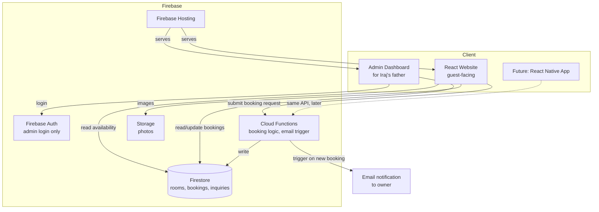

# System Design — Sunkhani Pahuna Ghar Resort Website

## 1. Architecture overview

An API-first architecture: the React frontend never talks to the database directly except through
Firebase's SDK (which itself enforces rules server-side), and all booking logic lives in Cloud
Functions rather than in frontend components. This keeps the door open for a future mobile app to
reuse the same backend without any rework.

## 2. Components

| Component | Purpose |
|---|---|
| React website | Public-facing pages, booking form, language toggle |
| Admin dashboard | Simple booking list + confirm/decline, for the owner |
| Firebase Auth | Restricts the admin dashboard to the owner's account only |
| Cloud Functions | Validates booking requests, checks for date overlaps, writes to Firestore, triggers email |
| Firestore | Stores rooms, bookings, and contact inquiries |
| Firebase Storage | Hosts property photos (alternative to bundling images in the frontend) |
| Firebase Hosting | Serves the built React site |

## 3. Booking flow

1. Guest picks a room type and dates on the Book Now page.
2. Frontend reads existing bookings for that room type from Firestore to gray out unavailable dates.
3. Guest submits the form → calls a Cloud Function (`createBooking`) rather than writing to Firestore
   directly, so overlap-checking and validation happen server-side.
4. Cloud Function checks the dates don't overlap an existing confirmed booking, then writes a new
   document to the `bookings` collection with status `pending`.
5. Cloud Function sends an email to the owner (via a service like SendGrid or Firebase's email
   extension).
6. Owner opens the admin dashboard, sees the pending booking, and marks it `confirmed` or `declined`.

## 4. Why Firebase

- No server to manage or pay for separately — fits a small, single-property business.
- Firestore + Auth work identically from a future React Native app, satisfying NFR6.
- Free tier comfortably covers a small resort's traffic.
- Firebase Hosting deploys the React build with one command.
